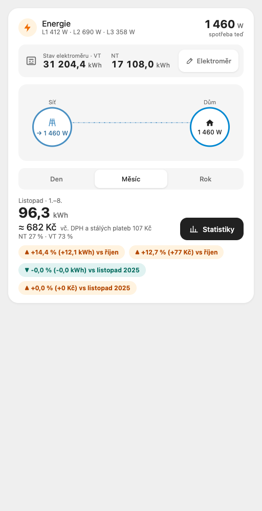
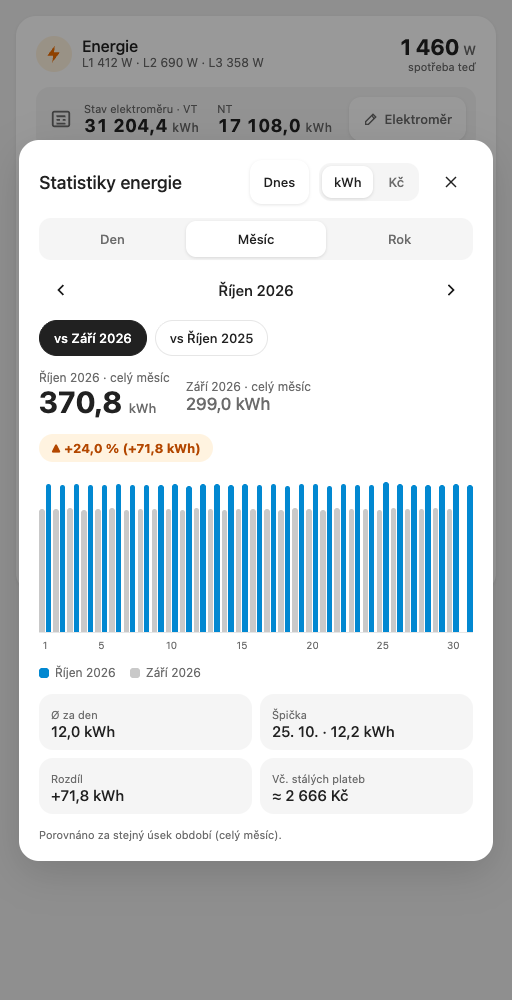
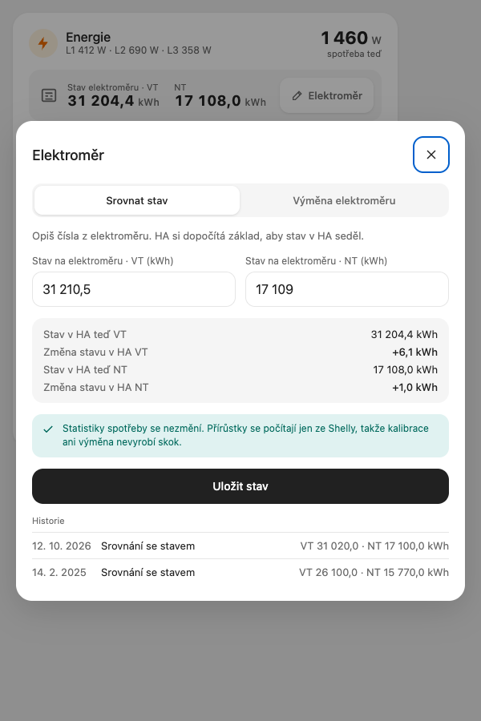

[English](README.md) · **Čeština**

# Energy Card

Karta do Home Assistantu pro elektřinu v domácnosti: kolik se spotřebovalo a kolik to stálo dnes, tento měsíc a tento rok, ve srovnání s předchozím obdobím a se stejným obdobím loni, a k tomu stav elektroměru tak, jak ho ukazuje skutečný elektroměr. Je dělaná pro české dvoutarifní smlouvy (VT / NT podle denní doby) a je v češtině.

| Karta | Statistiky | Elektroměr |
|---|---|---|
|  |  |  |

## Funkce

- **Hlavička**: aktuální příkon (W) a, pokud jsou nastavené, jednotlivé fáze (`L1 412 W · L2 690 W · L3 358 W`).
- **Stav elektroměru**: registry VT a NT (u jednotarifního ceníku jedna hodnota) s tlačítkem **Elektroměr** pro srovnání stavu a výměnu elektroměru.
- **Tok**: síť → dům s aktuálním příkonem (animace se zastaví, pokud má systém zapnuté omezení pohybu).
- **Den / Měsíc / Rok**: kWh, cena ≈ Kč vč. DPH a stálých plateb, podíl NT / VT a změna oproti předchozímu období a oproti loňsku, v kWh i v Kč. Srovnává se vždy stejný úsek: tento měsíc od 1. do dneška proti minulému měsíci od 1. do stejného dne a hodiny.
- **Statistiky**: sloupce po hodinách / dnech / měsících proti předchozímu období nebo loňsku, v kWh nebo Kč, průměr, špička, rozdíl a odhad za celé období; šipkami se lze posouvat zpět po dnech / měsících / letech (uplynulé období se srovnává celé), **Dnes** vrátí aktuální období.
- **Elektroměr**: srovnání registrů se skutečným elektroměrem, nebo záznam nového elektroměru (datum, konečný stav starého, počáteční stav nového); historie obojího.
- Přebírá barvu pozadí karty a textu z vašeho motivu.

## Instalace

**HACS (vlastní repozitář):** HACS → ⋮ → Vlastní repozitáře → `https://github.com/eMalinos/energy-card`, typ **Ovládací panel** (Dashboard) → stáhnout **Energy Card** → obnovit prohlížeč.

**Ručně:** zkopírujte [`dist/energy-card.js`](dist/energy-card.js) (nebo soubor z posledního release) do složky `config/www/` v Home Assistantu a přidejte ho jako resource dashboardu:

Nastavení → Ovládací panely → ⋮ → Zdroje → Přidat zdroj → URL `/local/energy-card.js?v=0.3.0`, typ **JavaScript modul** → obnovit prohlížeč.

Po nahrání nové verze změňte `?v=` v URL resource (např. `?v=0.3.0`), jinak prohlížeče drží starý soubor.

## Konfigurace

Feature `energy` v [ha-features-builder](https://github.com/eMalinos/ha-features-builder) tuto konfiguraci zapíše sama a vytvoří i entity elektroměru a skript. Ručně:

```yaml
type: custom:energy-card
energy_entity: sensor.energy_monitor_total_active_energy
power_entity: sensor.energy_monitor_total_active_power
phase_entities:
  - sensor.energy_monitor_phase_a_active_power
  - sensor.energy_monitor_phase_b_active_power
  - sensor.energy_monitor_phase_c_active_power
meter_vt: sensor.hfb_energy_meter_vt
meter_nt: sensor.hfb_energy_meter_nt
meter_history: sensor.hfb_energy_meter_history
meter_script: script.hfb_energy_meter_set
accent: "#0288d1"
price_lists:
  - name: ČEZ Refix D25d
    valid_from: "2025-02-01"
    valid_to: ""
    vt: 6045.56
    nt: 3551.62
    poze: 598.95
    fixed: 454.77
    nt_windows:
      workday: ["00:00-04:10", "16:55-18:55", "22:10-24:00"]
      weekend_holiday: ["01:55-05:50", "15:20-17:50", "22:25-24:00"]
```

| Volba | Povinná | Popis |
|---|---|---|
| `energy_entity` | ano | Celková energie, kWh, `state_class: total_increasing`. Všechny kWh a Kč se počítají z jejích hodinových dlouhodobých statistik. |
| `power_entity` | ano | Aktuální příkon, W. |
| `phase_entities` | ne | Až tři příkony fází, W, zobrazené jako L1–L3. |
| `meter_vt`, `meter_nt` | ano | Registry elektroměru (kWh), např. `utility_meter` s tarify `vt` a `nt`. Když dnešní ceník nemá NT, zobrazí se jen `meter_vt`. |
| `meter_history` | ano | Senzor, jehož atribut `entries` obsahuje seznam kalibrací, nejnovější poslední: `{time, kind: align \| replace, vt, nt, old_vt, old_nt}`. |
| `meter_script` | ano | Skript, který volá okno elektroměru (viz níže). |
| `price_lists` | ne | Ceníky, nebo tentýž seznam jako JSON řetězec. Bez ceníku se zobrazují kWh, ale ne Kč. |
| `accent` | ne | Barva zvýraznění, výchozí `#0288d1`. |

### Ceník

| Klíč | Popis |
|---|---|
| `name` | Popisek. |
| `valid_from`, `valid_to` | `YYYY-MM-DD`, oba včetně; prázdné `valid_to` = platí dosud. Ceníky se nesmí překrývat. |
| `vt`, `nt` | Cena za MWh vč. DPH („celková jednotková cena“ z ceníku ČEZ). `nt: null` = jednotarif. |
| `poze` | POZE za MWh vč. DPH. |
| `fixed` | Stálé platby za měsíc vč. DPH (stálý plat, jistič, …). |
| `nt_windows` | `workday` a `weekend_holiday`: okna NT `HH:MM-HH:MM`; `24:00` = půlnoc. |

### Skript elektroměru

**Uložit** zavolá `meter_script` s parametry:

| Pole | Popis |
|---|---|
| `kind` | `align` (srovnat stav s elektroměrem) nebo `replace` (nový elektroměr). |
| `vt` | Stav (align) nebo počáteční stav nového elektroměru (replace), kWh. |
| `nt` | Totéž pro NT; u jednotarifu se vynechá. |
| `old_vt`, `old_nt` | Jen u výměny, nepovinné: konečný stav starého elektroměru. |
| `date` | Jen u výměny: datum výměny, `YYYY-MM-DD`. |

## Jak se počítají Kč

- Hodinová spotřeba se bere z `recorder/statistics_during_period` (`period: hour`, `change`, v kWh) entity `energy_entity`, nikdy z registrů elektroměru, takže se srovnání stavu ani výměna elektroměru nikdy neprojeví jako spotřeba. Statistiky se cachují na 5 minut a pak se načtou znovu při další změně stavu (nástěnný tablet tak zůstává aktuální), o půlnoci pro Den a když se stránka znovu zobrazí.
- Srovnání pokrývá stejné celé hodiny: HA zapíše hodinový řádek až po skončení hodiny, takže aktuální období končí posledním řádkem (např. „do 14:00“) a předchozí období i loňsko se uříznou na stejném místě.
- Každá hodina se ocení ceníkem platným v daný den. Hodinu, kterou rozdělí okno NT, karta rozdělí po minutách: `kWh × (NT × podíl + VT × (1 − podíl) + POZE)`.
- Stálé platby se připočítávají poměrně: `fixed / počet dní v měsíci` za každý (i započatý) den období, podle ceníku platného v daný den.
- Hodiny bez platného ceníku se započítají do kWh, ale ne do Kč; karta pak zobrazí „část období bez ceníku“.
- Záporná hodina (vynulovalo se počítadlo měřiče energie) se počítá jako 0.

### VT / NT a státní svátky

Víkendy a české státní svátky používají okna `weekend_holiday`: 1. 1., Velký pátek, Velikonoční pondělí, 1. 5., 8. 5., 5. 7., 6. 7., 28. 9., 28. 10., 17. 11., 24.–26. 12. Velikonoce se dopočítávají (anonymní gregoriánský algoritmus).

### Omezení

- Dny, hodiny, okna NT i svátky se řídí **časovým pásmem prohlížeče**. Nastavte zařízení (nástěnný tablet, telefon) na časové pásmo Home Assistantu, jinak se hodiny rozdělí podle špatných hodin.

### Oprava staré záporné statistiky

Karta záporné hodiny ignoruje, vestavěný Energy dashboard v HA ale ne. Oprava: Vývojářské nástroje → Statistiky → najděte entitu energie → ikona úpravy → vyberte hodinu, kdy došlo k vynulování, a nastavte její změnu na 0 (nebo na skutečnou spotřebu té hodiny).

## Vývoj

Žádný build ani závislosti: zdrojem je přímo `dist/energy-card.js`.

```sh
node --test tests/*.test.mjs                 # pricing, holidays, ranges, config
python3 -m http.server 8765 &
"Google Chrome" --headless=new --virtual-time-budget=5000 --dump-dom http://localhost:8765/tests/dom.html | grep RESULT
```

`tests/dom.html?shot=card|stats|statsPast|meter` vykreslí kartu s falešným `hass` pro snímky obrazovky.

## Změny

- **0.3.0** čte tokeny `--hfb-*` motivu Homecraft (barvy, povrch karty, tlačítka, segmentový přepínač, čipy změn, ikona v hlavičce), každý s dosavadním HA fallbackem; bez tokenů vypadá karta jako ve verzi 0.2.2. Nenastavený `accent` následuje `--hfb-accent`.

## Licence

MIT
