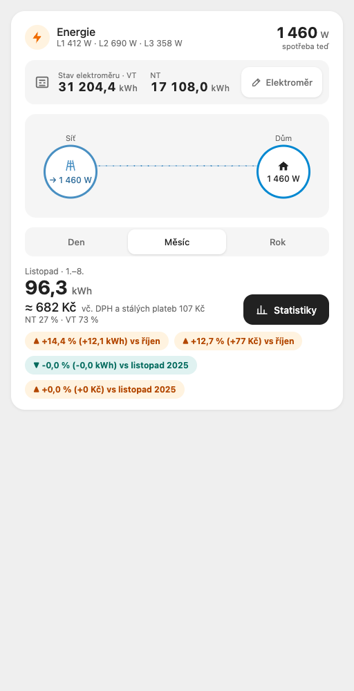
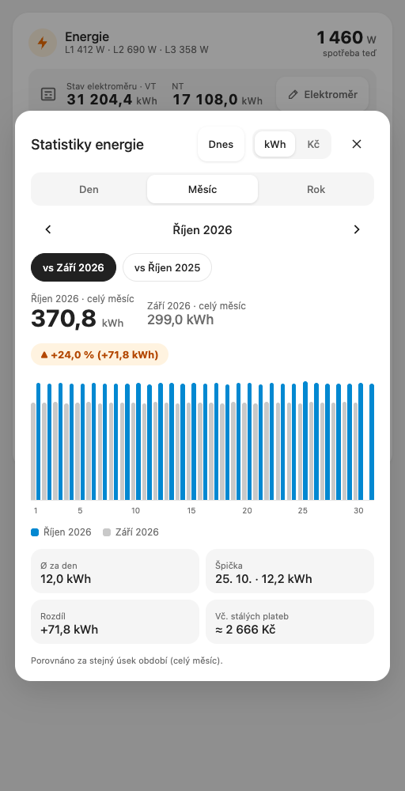
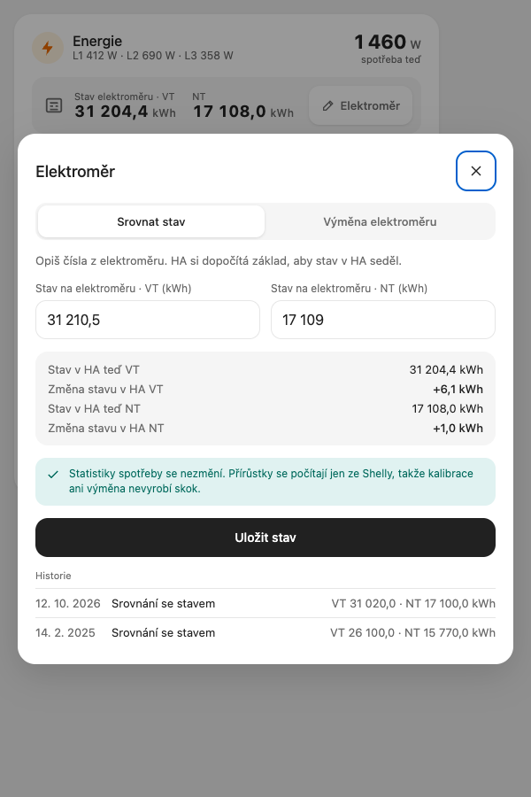

**English** · [Čeština](README.cs.md)

# Energy Card

A Home Assistant card for household electricity: how much was used and what it cost today, this month and this year, compared with the previous period and the same period last year, plus the meter reading as on the physical meter. Built for Czech two-tariff contracts (VT / NT by time of day) and written in Czech.

| Card | Statistics | Meter |
|---|---|---|
|  |  |  |

## Features

- **Header**: power now (W) and, when configured, the phases (`L1 412 W · L2 690 W · L3 358 W`).
- **Meter reading**: the VT and NT registers (one value with a single-tariff price list), with an **Elektroměr** button for calibration and meter replacement.
- **Flow**: grid → house with the current power (the animation stops with the system's reduce-motion setting).
- **Den / Měsíc / Rok**: kWh, cost ≈ Kč incl. VAT and fixed fees, the NT / VT share, and changes vs the previous period and vs last year, in kWh and in Kč. Comparisons are like-for-like: this month 1.–today against last month 1.–the same day and time.
- **Statistiky**: bars per hour / day / month against the previous period or last year, in kWh or Kč, average, peak, difference and an estimate for the whole period; arrows browse back by day / month / year (a past period compares whole periods), **Dnes** returns to the current one.
- **Elektroměr**: align the registers with the physical meter, or record a new meter (date, old meter's final values, new meter's start values); history of both.
- Follows your theme's card background and text colours.

## Installation

**HACS (custom repository):** HACS → ⋮ → Custom repositories → `https://github.com/eMalinos/energy-card`, type **Dashboard** → download **Energy Card** → reload the browser.

**Manual:** copy [`dist/energy-card.js`](dist/energy-card.js) (or the file from the latest release) to your Home Assistant `config/www/` folder, then add it as a dashboard resource:

Settings → Dashboards → ⋮ → Resources → Add resource → URL `/local/energy-card.js?v=0.2.1`, type **JavaScript module** → reload the browser.

After copying a new version, change `?v=` in the resource URL (e.g. `?v=0.2.1`), otherwise browsers keep the old file.

## Configuration

The [ha-features-builder](https://github.com/eMalinos/ha-features-builder) `energy` feature writes this config and creates the meter entities and the script. By hand:

```yaml
type: custom:energy-card
energy_entity: sensor.energy_monitor_total_active_energy
power_entity: sensor.energy_monitor_total_active_power
phase_entities:
  - sensor.energy_monitor_phase_a_active_power
  - sensor.energy_monitor_phase_b_active_power
  - sensor.energy_monitor_phase_c_active_power
meter_vt: sensor.hfb_energy_meter_vt
meter_nt: sensor.hfb_energy_meter_nt
meter_history: sensor.hfb_energy_meter_history
meter_script: script.hfb_energy_meter_set
accent: "#0288d1"
price_lists:
  - name: ČEZ Refix D25d
    valid_from: "2025-02-01"
    valid_to: ""
    vt: 6045.56
    nt: 3551.62
    poze: 598.95
    fixed: 454.77
    nt_windows:
      workday: ["00:00-04:10", "16:55-18:55", "22:10-24:00"]
      weekend_holiday: ["01:55-05:50", "15:20-17:50", "22:25-24:00"]
```

| Option | Required | Description |
|---|---|---|
| `energy_entity` | yes | Total energy, kWh, `state_class: total_increasing`. All kWh and Kč come from its hourly long-term statistics. |
| `power_entity` | yes | Power now, W. |
| `phase_entities` | no | Up to three phase powers, W, shown as L1–L3. |
| `meter_vt`, `meter_nt` | yes | Meter registers (kWh), e.g. a `utility_meter` with tariffs `vt` and `nt`. Only `meter_vt` is shown when today's price list has no NT. |
| `meter_history` | yes | A sensor whose attribute `entries` lists the calibrations, newest last: `{time, kind: align \| replace, vt, nt, old_vt, old_nt}`. |
| `meter_script` | yes | Script called by the meter pop-up (below). |
| `price_lists` | no | Price lists, or the same list as a JSON string. Without one, kWh are shown and Kč are not. |
| `accent` | no | Accent colour, default `#0288d1`. |

### Price list

| Key | Description |
|---|---|
| `name` | Label. |
| `valid_from`, `valid_to` | `YYYY-MM-DD`, both inclusive; empty `valid_to` = still valid. Lists must not overlap. |
| `vt`, `nt` | Price per MWh incl. VAT (the "celková jednotková cena" of the ČEZ price list). `nt: null` = single tariff. |
| `poze` | POZE per MWh incl. VAT. |
| `fixed` | Fixed fees per month incl. VAT (standing charge, breaker, …). |
| `nt_windows` | `workday` and `weekend_holiday`: NT windows `HH:MM-HH:MM`; `24:00` = midnight. |

### Meter script

**Uložit** calls `meter_script` with:

| Field | Description |
|---|---|
| `kind` | `align` (align with the meter) or `replace` (new meter). |
| `vt` | Reading (align) or the new meter's start value (replace), kWh. |
| `nt` | The same for NT; left out for a single tariff. |
| `old_vt`, `old_nt` | Replace only, optional: the old meter's final values. |
| `date` | Replace only: date of the replacement, `YYYY-MM-DD`. |

## How Kč are computed

- Hourly consumption comes from `recorder/statistics_during_period` (`period: hour`, `change`, in kWh) of `energy_entity`, never from the meter registers, so a calibration or meter replacement never shows up as consumption. Statistics are cached for 5 minutes, reloaded after that on the next state update (a wall tablet keeps up), at midnight for Den, and when the page becomes visible again.
- Comparisons cover the same complete hours: HA writes an hourly row after the hour ends, so the current period ends with its last row (e.g. "do 14:00") and the previous period and last year are cut at the same offset.
- Each hour is priced by the list valid that day. An hour an NT window cuts is split by minutes: `kWh × (NT × share + VT × (1 − share) + POZE)`.
- Fixed fees are added pro rata: `fixed / days in the month` for every (part of a) day in the period, by the list valid that day.
- Hours with no valid price list count in kWh but not in Kč; the card then notes "část období bez ceníku".
- A negative hour (the energy meter counter was reset) counts as 0.

### VT / NT and public holidays

Weekends and Czech public holidays use the `weekend_holiday` windows: 1. 1., Good Friday, Easter Monday, 1. 5., 8. 5., 5. 7., 6. 7., 28. 9., 28. 10., 17. 11., 24.–26. 12. Easter is computed (anonymous Gregorian algorithm).

### Limitations

- Days, hours, NT windows and holidays use the **browser's timezone**. Set the device (wall tablet, phone) to the Home Assistant timezone, otherwise hours are split by the wrong clock.

### Fixing an old negative statistic

The card ignores negative hours, but HA's own Energy dashboard does not. To fix one: Developer tools → Statistics → find the energy entity → the adjust icon → pick the hour of the reset and set its change to 0 (or the real consumption of that hour).

## Development

No build step and no dependencies: `dist/energy-card.js` is the source.

```sh
node --test tests/*.test.mjs                 # pricing, holidays, ranges, config
python3 -m http.server 8765 &
"Google Chrome" --headless=new --virtual-time-budget=5000 --dump-dom http://localhost:8765/tests/dom.html | grep RESULT
```

`tests/dom.html?shot=card|stats|statsPast|meter` renders the card with a fake `hass` for screenshots.

## License

MIT
